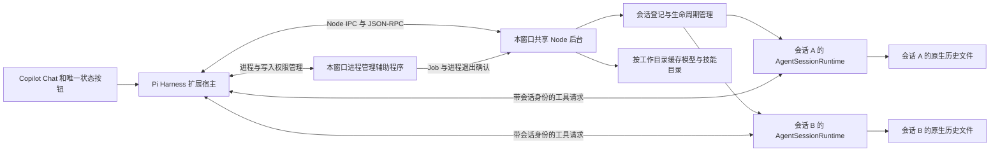

# Pi Harness 共享后台与问题修复实施方案

日期：2026-11-04。文档状态：研究完成后的实施设计；业务代码、已安装扩展和用户设置尚未修改。

## 实施目标

用户在 Copilot Chat 中使用 Pi 时，多个会话共用本窗口的后台服务，能够独立执行、停止、恢复、reload 和交给终端继续；日期提示、消息回退、启动窗口、技能菜单、默认排队和状态栏行为满足本文验收条件。状态栏固定显示一个 Pi 按钮，悬停显示活动会话数量、会话名称与状态，以及共享后台进程的 CPU 和内存占用。单会话 reload 刷新该会话使用的资源，保留会话身份与历史，其他会话继续运行。

## 当前依据与问题范围

本次读取的项目为项目根目录，当前分支为 `main`；实施前应重新读取将要修改的文件。基准为项目 Pi Harness 0.1.0、已安装 Pi 1.5.0、Node.js 24.15.0、日常 VS Code 1.144.1；本地 VS Code 源码副本为 1.144.0，关键新增接口已经核对日常安装文件。现有验收记录覆盖 1.144.0 和 1.144.1，但不能代替本次改造的验收。

| 编号 | 用户要求或问题 | 已确认的依据 | 完成条件 |
|---|---|---|---|
| R1 | 多个 Chat 共用后台，参考 Codex harness 管理会话 | 当前每个 `PiSession` 创建一个 `PiRpcProcess`，模型列表还使用独立进程；Pi SDK 提供独立会话对象 | 一个 VS Code 窗口共用一个 Pi 后台和一个进程管理辅助程序；多个 Chat 可并发，单个会话操作不影响其他会话 |
| R2 | 会话列表前半段悬停时出现日期字符串并闪烁 | `SessionList` 将包含日期的会话文件路径设为 tooltip；列表每次刷新都会替换全部条目；未复现完整闪烁过程 | 移除文件路径 tooltip；悬停与列表刷新期间选择保持稳定；原生日期排序正常 |
| R3 | 编辑此前消息后的回退失败 | 真实日志的两次失败发生在原回复完成之前；Pi 原生导航拒绝执行中的会话；扩展命令错误可转换成 `extension_error`，RPC 仍返回 `handled` | 执行中、执行后和重开历史后编辑消息均能正确停止、回退并提交；原始错误准确显示 |
| R4 | 启动 Pi 时有窗口短暂显示 | Harness 启动已设置 `windowsHide`；既有三次诊断均未捕获显示事件；Pi 部分子进程创建位置未显式设置该参数 | 对实际 Chat 启动流程记录窗口事件和进程关系，修复已确定的创建位置并完成重复验收 |
| R5 | 运行中发送下一条消息默认排队 | VS Code 的 `chat.requestQueuing.defaultAction` 默认值为 `steer` | Enter 排队，明确选择引导时仍能引导；界面队列与实际执行顺序一致 |
| R6 | `/` 菜单显示并调用 Pi 技能 | Pi 已读取技能；Harness 只声明 `compact`；VS Code 提供按会话查询技能的 proposed API | 菜单来自当前会话的 Pi 资源；技能内容仅展开一次，参数与附件保留 |
| R7 | 状态栏固定单按钮，悬停显示会话与进程信息 | 当前每个会话创建状态栏项，原样拼接 ANSI 文字，退出时仍可能保留旧状态 | 全窗口只有一个固定 Pi 按钮；悬停数据准确，没有颜色控制字符和已结束会话的残留 |
| R8 | 支持单会话 reload | Pi 提供资源加载与扩展生命周期接口；共享后台需要按所属会话安排重建 | Chat `/reload` 和会话菜单均可使用；资源更新生效，身份与历史保留，执行中请求等待本轮结束，其他会话继续 |

状态栏原文中的费用与 LSP 文字分别来自 `pi-token-usage`、`pi-lens` 的带颜色状态输出。实施后的悬停面板使用后台提供的结构化会话与进程信息。

## 阶段 0：核对接口与建立真实验证环境

本阶段让实施使用当前安装版本确实提供的接口，并建立能够验证多会话隔离和用户反馈问题的环境。

### 已核查的接口

| 所属 | 可使用的接口 | 本方案用途与来源 |
|---|---|---|
| Pi | `createAgentSessionServices(options)`、`createAgentSessionFromServices(options)`、`createAgentSessionRuntime(factory, options)` | 每个 Chat 拥有独立服务与运行时；官方示例 [13-session-runtime.ts](node_modules/@earendil-works/pi-coding-agent/examples/sdk/13-session-runtime.ts) |
| Pi | `DefaultResourceLoader`、`SettingsManager`、`createCodemodeExtension()`、`createToolSearchExtension()`、`createMcpExtension()` | 保留资源发现、技能和 CLI 内置功能；官方示例 [14-codemode-mcp.ts](node_modules/@earendil-works/pi-coding-agent/examples/sdk/14-codemode-mcp.ts) |
| Pi | `SettingsManager.fromStorage(storage, options)`、`SettingsStorage.withLock(scope, fn)`、`getGlobalSettings()`、`getProjectSettings()` | 建立仅供资源加载使用的配置视图，在扩展执行前替换兼容包来源；[SettingsManager 声明](node_modules/@earendil-works/pi-coding-agent/dist/core/settings-manager.d.ts) |
| Pi | `session.subscribe()`、`prompt()`、`steer()`、`followUp()`、`clearQueue()`、`abort()`、`waitForIdle()`、`navigateTree()`、`bindExtensions()` | 执行、消息管理、导航与扩展绑定；[AgentSession 声明](node_modules/@earendil-works/pi-coding-agent/dist/core/agent-session.d.ts) |
| Pi | `AgentSessionRuntime.dispose()` | 发送 `session_shutdown` 并释放当前会话；[运行时实现](node_modules/@earendil-works/pi-coding-agent/dist/core/agent-session-runtime.js:296) |
| Pi | `SessionManager.create()`、`open()`、`getSessionId()`、`getLeafId()`、`getBranch()` | 保留原有会话文件、身份和分支；[SessionManager 声明](node_modules/@earendil-works/pi-coding-agent/dist/core/session-manager.d.ts) |
| Pi | `session.resourceLoader.getSkills().skills`、`ModelRuntime.getAvailableSnapshot()` | 查询有效技能和模型；[ResourceLoader 声明](node_modules/@earendil-works/pi-coding-agent/dist/core/resource-loader.d.ts)、[ModelRuntime 声明](node_modules/@earendil-works/pi-coding-agent/dist/core/model-runtime.d.ts) |
| VS Code | `registerChatSessionCustomizationProvider()`、`ChatSessionCustomizationType.Skill`、提供方 `onDidChange` | 将 Pi 技能接入 `/`；[完整声明](./.review-tmp/vscode/src/vscode-dts/vscode.proposed.chatSessionCustomizationProvider.d.ts) |
| VS Code | `ChatSessionInputState.onDidDispose`、`ChatSessionItemCollection.add/delete/get` | 跟踪内容引用和更新列表；[会话接口](./src/vscode-dts/vscode.proposed.chatSessionsProvider.d.ts) |
| VS Code | `createStatusBarItem()`、`MarkdownString.appendText()` | 创建窗口级唯一状态按钮和纯文字悬停内容 |
| Node.js | `fork()`、`process.cpuUsage()`、`process.memoryUsage.rss()`、`stripVTControlCharacters()` | 后台启动、占用统计及显示文字处理；[process 声明](./node_modules/@types/node/process.d.ts)、[util 声明](./node_modules/@types/node/util.d.ts:916) |
| Node.js | `DatabaseSync`、`exec()`、`prepare()`、`StatementSync.run/get/all()` | 使用 Node.js 24.15.0 的 `node:sqlite` 保存恢复操作；[本机类型声明](./node_modules/@types/node/sqlite.d.ts:292) |
| vscode-jsonrpc | `createMessageConnection()`、`IPCMessageReader`、`IPCMessageWriter` | 扩展宿主与后台使用 Node IPC 通信；[接口声明](./node_modules/vscode-jsonrpc/lib/node/main.d.ts:6) |

Codex 的参考行为来自 [CodexAgent](./.review-tmp/vscode/src/vs/platform/agentHost/node/codex/codexAgent.ts:983) 和 [AgentSessionResidency](./.review-tmp/vscode/src/vs/platform/agentHost/node/agentSessionResidency.ts:18)。Harness 自己实现会话管理，不导入 VS Code 内部类。

### 实施工作

1. 记录执行时的 Pi、Node.js、VS Code 和第三方扩展版本，以及所修改源文件的校验值。
2. 测试目录统一使用已被忽略的 `./.test-work/`；准备两个真实工作目录和独立 VS Code 用户数据目录。
3. 沿用现有真实模型、Pi 扩展与 MCP 配置，记录启用项目。会话历史和测试项目写入测试目录，使用用户原有凭据时仅由 SDK 读取。
4. 保存各问题的可重复操作、事件顺序和断言。回退问题记录实际 Pi 状态、请求 ID、用户条目 ID、叶子 ID、操作时间；启动问题记录窗口事件与 PID。
5. 创建真实 SDK 验证程序，覆盖同目录双会话、不同目录双会话、运行中的子代理、单会话释放、技能和 MCP。该程序属于实施验收基础，不能用模拟 provider 或替换 SDK 对象通过检查。
6. 后台与进程管理辅助程序的 Node.js 最低版本确定为 24.15.0，验证 `node:sqlite` 的事务提交、关闭后重新打开和异常退出恢复。Windows 进程管理使用 Koffi 绑定 Win32 Job Object；固定经过实际 VS Code 扩展宿主加载检查的依赖版本，将对应原生文件与许可纳入 VSIX。类型、加载或 Job 分配失败时停止后台初始化。

**验收：** 所用 API 的类型检查通过；测试资料与用户日常会话分开保存；结果中明确记录未执行项目。读取文件和结构化 UI 信息即可完成核查，使用 WinEventHook 记录短暂窗口。

**实现约束：** 使用库提供的 JSON-RPC、会话解析与资源解析接口；错误在对应操作处报告；接口缺失时明确终止该功能初始化，不静默省略功能。

## 阶段 1：建立共享后台与会话资源隔离

本阶段让多个 Chat 共用一个后台进程，同时保留各自的模型、目录、工具、历史和扩展状态。

### 运行结构

每个 VS Code 窗口按需启动一个独立 Node 后台，完整 Pi SDK 只在该后台加载。另有一个窗口级进程管理辅助程序，使用同一 Node.js 与 Koffi，负责进程退出确认和跨窗口写入权限，不加载 Pi 或用户扩展。扩展宿主负责 VS Code 界面、文件修改保护、Copilot 工具和状态按钮。外部工具及 MCP 可以按其功能创建子进程；状态面板分别显示 Pi 后台与管理辅助程序的真实占用。

每个会话拥有独立的 `AgentSessionRuntime`、`SessionManager`、`ModelRuntime`、`SettingsManager`、`DefaultResourceLoader`、扩展绑定、队列和事件订阅。工作目录与连接对象通过构造参数传入。默认模型和思考级别的会话选择使用 Pi 的非持久化选项，保持其他会话的当前选择。

### 通信与编辑器连接

- 新建项目内的后台入口、连接类、会话登记类和资源工厂；这些是待实现的 Harness 模块，不作为 Pi 现有 API 引用。
- 使用 Node 的 IPC 通道承载 `vscode-jsonrpc`，后台的日志使用标准错误输出。第三方扩展的普通输出不会混入通信数据。
- 请求、响应、事件和编辑器工具调用统一携带 `sessionId`、后台启动代次、请求 ID；运行事件增加轮次 ID 和会话内递增序号。旧后台、旧轮次和已释放绑定的消息不得改变当前界面。
- 将 [pi-extension/index.ts](./pi-extension/index.ts:64) 改为接收会话配置的内联扩展工厂，保留现有编辑器工具、快照记录和请求映射。每个工厂创建自己的连接访问对象、工具集合与 `AsyncLocalStorage`。
- 文件工具直接使用该会话的 `cwd`；会话身份与临时配置通过对象传递。共享后台运行期间不通过更改全局工作目录或环境变量来切换会话。
- 编辑器端按规范化文件路径串行执行提交，从读取并核对修改基准、保存快照到实际写入使用同一次提交操作。两个会话修改同一文件时，后到的提交重新核对真实内容与文档版本，发现冲突立即报告给所属会话。
- 主会话、进程内子会话和独立后台 runner 的 `edit`、`write` 使用同一编辑器提交接口。通过构造参数传递 `parentSessionId`、`rootRequestId`、`runId`、操作代次和经过验证的连接；多层子任务继承根请求身份。每项写入均保存前后快照。连接断开、身份过期或没有编辑器确认时直接失败。
- `ctx.shutdown()` 在本接入中请求释放所属会话；扩展宿主整体断开才进入后台关闭流程。
- 模型与技能查询移入后台。按工作目录创建资源服务，使用 `createAgentSessionServices()` 注册扩展提供的模型并查询资源。需要会话方法计算模型能力时，使用 `SessionManager.inMemory()` 的目录查询会话，完成后按完整生命周期释放；它不加入 Chat 列表或活动会话数量。
- 复制官方示例的内置扩展创建与绑定模式，保留用户已有的工具选择、技能路径、prompt templates、MCP、上下文文件和工作区信任检查。

### 当前第三方扩展的必要兼容修改

| 包与版本 | 已确认的共享状态 | 必须实现的行为 |
|---|---|---|
| `pi-subagents` 0.84.0 | `activeFactory`、全部 `live children`、思考级别来源回调、slash 进度缓存；部分启动参数临时写入 `process.env`；部分描述与脚本路径取进程目录 | 按父会话身份分别持有 factory、子任务、回调与缓存；释放或 reload 只处理所属会话；启动参数与 `cwd` 显式传递 |
| `@router-for-me/pi-cliproxyapi-provider` 1.4.24 | shutdown 路径无参数关闭共享的 OpenAI Codex WebSocket 会话集合 | 将所属 Pi 会话 ID 传入关闭接口；检查压缩等其他关闭位置，确保只处理对应会话 |
| `pi-lens` 4.4.8 | 已有进程内多会话和引用计数管理 | 保留其进程级服务机制，验证关闭一个 Chat 后其他 Chat 的 LSP 和编辑检查继续可用 |
| Pi 1.5.0 内置 MCP | 公开 `createMcpExtension()` 没有连接状态回调，初始化和关闭包含异步工作 | 使用具有版本记录的 MCP 兼容工厂报告结构化连接、工具注册及关闭结果，供 reload 判定完成；保留原配置与协议实现 |

兼容修改保存为有版本、来源和构建记录的项目依赖，并在 Harness 的资源配置中选择对应兼容包。加载方式使用 Pi 的公开接口：

1. 原始 `SettingsManager` 负责读取和保存用户设置；另建资源专用的 `SettingsManager.fromStorage()` 视图。
2. 资源视图的 `SettingsStorage.withLock()` 从原始管理器取得对应 scope 的设置副本，将匹配的 `packages`、`extensions` 来源映射为兼容包绝对路径，同时保留原来源的资源过滤配置。序列化使用标准 JSON 接口。
3. 调用 `createAgentSessionServices({ settingsManager: resourceSettings, ... })` 完成资源加载与扩展 provider 注册；根据它返回的公开 `AgentSessionServices` 字段形成副本，将 `settingsManager` 指向原始管理器，将 `resourceLoader` 指向资源包装对象，再传给 `createAgentSessionFromServices()`。包装对象在 `reload()` 前刷新原始设置，同步项目是否受信任及诊断结果。资源视图的写入只影响该视图；`resourceLoaderOptions` 中不传入其类型未声明的 `settingsManager`。
4. 包来源映射在 `packageManager.resolve()` 与扩展工厂执行之前生效。`applyOverrides()` 不能单独完成这一替换；`extensionsOverride` 的执行时间也晚于原工厂初始化。
5. 将相同的来源映射传入 `pi-subagents` 的子会话创建路径、显式 `extensionPaths`、`requiredExtensions` 及后台 runner，保留子会话的扩展身份核对。主 Chat 与其子任务使用同一套兼容版本。
6. `pi-subagents` 的兼容实现向 Harness 暴露按所属根请求停止、等待结束和查询剩余任务的接口。这些是项目新增接口。沿用现有 [后台停止处理](compat/pi-subagents/src/runs/foreground/async-stop-action.js:133)，等待实际 runner 退出及所属工具操作结束；启动中任务在登记后才允许执行，停止状态禁止创建后代任务。无法确认远程任务结束时报告未结束并保持保护状态。
7. 进程内 child 的 `extensionFactories` 和独立 runner 的 `extensionBindings` 都接入 Harness 文件工具。沿用 [child 创建位置](compat/pi-subagents/src/runs/shared/child-session.js:435) 和 [runner 参数传递](compat/pi-subagents/src/runs/background/runner-child-launch.js:42)，确保独立 runner 的默认文件工具已由相同提交接口替换。停止确认覆盖其创建的本地命令进程。

用户终端所使用的包和配置继续独立管理；扩展激活时不修改全局安装目录。

已确认的扩展来源：[pi-subagents](compat/pi-subagents/src/extension/index.js)、[子会话资源](compat/pi-subagents/src/runs/shared/child-session.js)、[slash 状态](compat/pi-subagents/src/slash/slash-live-state.js)、[模型提供方关闭处理](compat/pi-cliproxyapi-provider/extensions/index.ts:811)。兼容包构建记录应包括这些来源的版本、文件和校验值。

`pi-subagents` 的修改沿用已有 `ChildRuntimeConfig.parentSessionId` 与 `options.childSessionFactory` 传递所属关系。每个父会话分别保存子任务、启动中的任务、MCP 等待项和释放过程。思考级别回调、slash 缓存与 custom 工具描述使用对应会话的状态与目录。模型提供方在关闭时必须取得有效 session ID，并调用 `closeOpenAICodexWebSocketSessions(sessionId)`；现有按实例引用管理的 provider 注册继续保留。

共享会话结构可使用 Pi 1.5.0 现有 SDK 接口。上述第三方扩展的兼容修改属于本次实施范围；启动窗口问题的修复位置由阶段 6 的实际进程记录确定。

**修改位置：** [piRuntime.ts](./src/pi/piRuntime.ts)、[rpcProcess.ts](./src/pi/rpcProcess.ts)、[catalog.ts](./src/pi/catalog.ts)、[hub.ts](./src/session/hub.ts)、[piSession.ts](./src/session/piSession.ts)、[protocol.ts](./shared/protocol.ts)、[构建脚本](./scripts/build.mjs)。拟新增后台代码目录为 `./src/backend/`，兼容依赖目录为 `./compat/`。

**验收：** 两个真实 Chat 的后台 PID 相同；各自工作目录、回复、模型、工具结果、子代理进度和历史文件正确；关闭 A 后 B 的模型流、子代理和 LSP 继续；重载 A 的扩展不清除 B 的缓存。目录查询不创建持久化 Chat，不更改默认模型设置。记录主会话及其子任务实际加载的扩展路径，确认兼容来源生效且原工厂未重复初始化；并发修改同一文件时验证冲突检查。真实执行进程内 child、后台 runner 和多层 child 的文件修改，确认快照、根请求身份、停止确认与过期写入拒绝均生效。

**实现约束：** 每个 Chat 使用独立运行时；完整释放通过 `AgentSessionRuntime` 完成；全局缓存仅保存确实可共享的数据，带会话所有权的资源必须按会话释放。

## 阶段 2：统一生命周期、订阅、停止、恢复和 reload

本阶段让关闭界面、停止任务、重新加载资源、释放会话和结束后台具有明确行为，并保留终端交接与历史恢复能力。

### 会话规则

| 操作 | 行为 |
|---|---|
| 打开历史 | 检查恢复操作记录，未完成时显示恢复状态并限制发送；读取原生会话文件，不自动执行模型任务 |
| 发送消息 | 获取该会话写入权限，完成必要恢复，确保运行时已加载，再接受请求 |
| 回复完成 | 以 `agent_settled` 判断本次自动执行结束，保留可恢复的运行时 |
| 界面内容释放 | 解除相应订阅；正在执行的会话继续运行 |
| 停止任务 | 清除该会话已提交给 Pi 的待处理消息，执行 `abort()`，停止所属本地前台及后台子任务并等待结束；其他会话继续 |
| reload 会话 | 空闲时立即重新加载资源；执行中登记重载请求，等待所属轮次、子任务、交互和文件提交结束；保留原会话身份、历史与待发送消息 |
| 释放空闲会话 | 按最近使用顺序释放符合条件的会话，保留原历史文件 |
| 归档 | 更新归档状态；满足释放条件时释放运行时 |
| 交给终端 | 等待目标会话空闲，完成关闭并释放写入权限，再用原文件打开终端 |
| 删除 | 沿用明确的删除操作和回收站流程，完成目标会话释放后操作文件 |
| 后台异常退出 | 所有受影响请求显示中断；结束旧 Job 的全部成员并保存清理完成记录；重新打开时检查进程归属及未完成恢复，满足接管条件后才允许明确发送 |

保留会话的目标数量默认 **10**，配置项拟为 `piHarness.sessionResidencyLimit`。超出目标时，只释放没有界面订阅、没有运行轮次、没有所属子任务、没有排队工作、没有待答交互、没有文件提交、未完成恢复、重载或交接操作的会话。运行中或仍被使用的会话允许使数量超过目标。归档会话优先检查释放条件。重试释放间隔为 30 秒；该间隔用于处理暂时不能释放的会话。

`ChatSessionInputState.onDidDispose` 反映 VS Code 的引用释放；用户切换界面与引用释放可能有时间差。新建会话被 VS Code 保留引用时，计入被使用的会话，不能把目标数量解释成绝对上限。

### 顺序与恢复

- 每个会话有独立的控制操作序列，处理打开、提交、停止、导航、重载、释放和交接。不同会话可并行。
- 发送操作只在确定身份和接受任务期间占用控制序列。等待模型回复的 Promise 不阻塞停止操作。
- 释放前后都重新检查会话代次、订阅和工作状态；释放与新请求同时到达时，由同一个控制序列决定结果。
- 状态由后台 Pi 对象和事件确认。扩展宿主只维护显示快照，不能仅凭响应流是否存在判断 Pi 已结束。
- 新订阅先取得当前快照和序号，再接收后续事件；重开运行中的 Chat 时补回尚未写入历史的内容，并按序号去重。
- `WriteLock` 继续按会话控制写入，由进程管理辅助程序持有。取得锁后，必须检查同一会话操作数据库中的旧进程归属和清理状态，满足下述接管条件才能授权后台。普通会话完整关闭后，先保存该次归属的 `released` 状态，再释放锁，其他会话继续使用原 Job；后台异常退出时持续持有锁，直到旧 Job 清理完成。原生终端 Pi 不参与该锁，因此继续沿用已有的终端写入方确认。
- 普通会话关闭的顺序固定为：停止接受新工作，清理待处理队列，停止所属子任务并等待实际结束，等待 `session.abort()` 与已开始的文件提交结束，监听并等待 `runtime.dispose()` 发出的 `session_shutdown` 及 MCP 真实关闭结果，刷新设置保存和会话记录，最后释放写入权限。关闭错误与 reload 使用相同的生命周期错误收集方式；退出状态未确认时保留保护状态。
- `/reload`、会话菜单和扩展命令的 `ctx.reload()` 统一进入下述单会话 reload 流程。
- `piHarness.idleShutdownMinutes` 从有效生命周期配置中移除并标记为弃用；新的会话数量配置采用上述默认值。实施迁移记录说明其含义，不在扩展激活时重写用户设置文件。
- 后台整体关闭使用下述窗口级关闭流程；单会话停止或 reload 失败只限制所属会话，保留其他会话的运行状态。

**依据：** [原生命周期](./src/session/piSession.ts:498)、[输入状态引用](./src/chat/sessionOptions.ts:84)、[写入权限](./src/sessions/writeLock.ts)、[终端交接](./src/commands.ts:126)、[Codex 的释放条件](./.review-tmp/vscode/src/vs/platform/agentHost/node/agentSessionResidency.ts:350)、[Pi reload](node_modules/@earendil-works/pi-coding-agent/dist/core/agent-session.js:3016)、[ExtensionRunner.emit](node_modules/@earendil-works/pi-coding-agent/dist/core/extensions/runner.d.ts:181)。

**验收：** 真实创建 12 个会话并验证释放顺序；运行、等待交互、有订阅的会话保留；停止 A 不停止 B；关闭再打开 Chat 不重复回复；同一文件不能被两个 Harness 窗口同时写入；终端交接与重开后继续使用同一个 Pi session ID；后台异常退出后每个会话分别恢复。

**实现约束：** 停止、订阅解除、运行时释放和进程退出分别建模；待处理请求不得自动重复发送；进程清理仅针对本窗口记录的所属进程。

### 窗口关闭与进程所有权

本机 VS Code 只等待扩展停用最多 5 秒，见 [terminate()](./.review-tmp/vscode/src/vs/workbench/api/common/extHostExtensionService.ts:267)。从 `deactivate()` 进入时开始计算，Harness 的总关闭预算为 **4 秒**：前 3 秒并行完成各会话停止、保存与关闭；到第 3 秒仍有所属进程时执行强制终止，剩余 1 秒核对退出并记录结果。实现使用同一个截止时间，各阶段使用剩余时间。停用期间仅依赖已经持有的文件、进程和连接对象。

进程管理辅助程序为每个后台启动代次创建独立 Job Object，使用 `Global\PiHarness-<randomUUID>` 名称、限制当前用户访问的安全描述符及不可继承句柄，设置 `JOB_OBJECT_LIMIT_KILL_ON_JOB_CLOSE`，不允许后台创建脱离 Job 的后代。`CreateJobObjectW` 报告 `ERROR_ALREADY_EXISTS` 时拒绝复用。宿主与辅助程序各持有一个 Job 句柄；辅助程序运行于该 Job 外。通过真实启动验证其能够在扩展宿主结束后完成清理，单独设置 `detached` 不作为证明。

使用 Koffi 的 `load()`、`func()` 绑定 `CreateJobObjectW`、`OpenJobObjectW`、`SetInformationJobObject`、`AssignProcessToJobObject`、`QueryInformationJobObject`、`TerminateJobObject`、`OpenProcess`、`GetProcessTimes`、`WaitForSingleObject`、`GetLastError` 和 `CloseHandle`，并使用 Win32 安全描述符接口限制命名对象访问。宿主与辅助程序通过真实进程句柄及创建时间核对对方身份，并等待退出信号。等待过程不能阻塞宿主事件处理。[Win32 Job Object](https://learn.microsoft.com/en-us/windows/win32/procthread/job-objects)、[Koffi 调用方式](https://koffi.dev/load)说明相关接口规则。

后台通过 `fork()` 启动后，只运行受控启动入口：立即监听 IPC 断开，等待 Job 分配与管理辅助程序确认，期间不加载 Pi、扩展或创建子进程。启动入口设置短期握手期限；IPC 断开、宿主已经退出或分配失败即结束自身。辅助程序验证实际进程身份并分配 Job，宿主确认自身持有对应 Job 句柄后才允许初始化 SDK。为会话授权前，辅助程序在阶段 3 的同一 SQLite 数据库保存独立 `ownershipId`、后台 `generationId`、Job 名称、宿主与辅助程序的 PID 和创建时间、`running` 状态；提交成功才允许所属模型、工具和文件操作。同一后台中释放后重新取得的会话使用新 `ownershipId`。

后台 `exit` 或 IPC 永久断开时，辅助程序立即撤销该代次授权，停止派发与接纳新进程，调用 `TerminateJobObject` 结束旧 Job 成员，并通过 `QueryInformationJobObject(JobObjectBasicAccountingInformation)` 确认 `ActiveProcesses=0`。随后事务保存各所属会话的 `cleaned` 状态，才能释放写入权限或建立新代次。宿主结束时，辅助程序按同样顺序处理。辅助程序异常结束时，宿主立即使旧启动确认和任务派发失效，禁止旧 Job 接纳新进程，通过保留的 Job 句柄执行清理；确认成员数量为零后，由新辅助程序在任何 SDK 初始化和会话授权之前保存旧代次的 `cleaned` 状态。清理记录仅按旧 `generationId`、`ownershipId` 和所有者身份更新对应记录；提交此证明不要求重新取得会话 `WriteLock`，即使另一窗口已持有锁并等待，也能完成记录。该操作仅更新旧归属元数据，不授予会话写入权限。全部清理和重建按后台代次串行安排，旧回调只能更新自身代次。清理超时或失败时保持保护；窗口关闭沿用统一 4 秒预算。

任何窗口取得 `WriteLock` 后，都先检查旧归属记录。`released` 表示该会话已完成独立关闭，`cleaned` 表示所属 Job 已确认没有进程，两种状态均允许检查后续恢复；旧状态仍为 `running` 时，不能恢复文件或派发任务。原所有者仍存在时等待其完成清理；两个所有者都已结束时，可通过记录的唯一 Job 名称尝试接管清理，使用 `JOB_OBJECT_QUERY | JOB_OBJECT_TERMINATE` 权限成功打开后执行终止、确认成员数量为零并保存 `cleaned`。Job 名称不存在、查询失败或权限不足都不能单独证明进程已经结束，继续保持保护并显示具体原因；原生对象名称与对象最终销毁的时序见 [对象生命周期](https://learn.microsoft.com/en-us/windows-hardware/drivers/kernel/life-cycle-of-an-object)。原进程退出仅凭 PID 不作判定，始终核对创建时间。每次授权的新代次保留独立记录，旧清理结果不能覆盖新所有者。

未完成恢复、进程归属及子任务归属在执行期间持续保存，窗口退出无需依赖最后一次异步写入才能发现未完成操作。删除、归档和终端交接必须遵守同一接管及恢复检查。主动“在终端中继续”在所属会话完整关闭并释放权限后由 VS Code 终端接口启动，其进程独立于后台 Job。部署目标的 Koffi 原生文件、管理辅助程序、后台入口和兼容依赖必须包含在 VSIX；实际扩展宿主加载、Job 分配、后代继承或辅助程序存活验证失败时停止发布。

**验收：** 正常退出、重载窗口、关闭中的扩展异常、同步阻塞后台、后台异常退出而宿主继续运行、宿主异常结束、辅助程序异常结束、两者同时结束，以及启动确认前宿主结束；逐一核对 Job 中的后台与本地子进程全部结束，其他窗口与主动终端保持运行。后台退出时已有命令后代仍在运行的场景必须验证跨窗口争用；任何 `cleaned` 记录保存失败或旧进程退出尚未确认的情况均限制恢复和发送。检查成员归零、记录提交、权限释放和新后台初始化的严格顺序，以及无退出证明时保护状态的显示与重试条件。

### 单会话 reload

**操作入口与反馈**

- 在 `package.json` 的 Chat 命令中声明 `/reload`。`PiParticipant` 完成目标身份、信任与权限检查后优先分流控制命令，再处理普通消息的模型选择、历史差异和 prompt；该命令刷新运行资源，Pi 历史中不追加模型消息，也不调用模型。
- 会话菜单提供“重新加载会话”，命令拟为 `piHarness.reloadSession`，参数使用选中条目的稳定资源 URI。命令面板中使用当前 Pi Chat；缺少目标会话时显示已有会话选择列表。
- `ExtensionBindings.commandContextActions.reload` 接入相同控制接口，扩展调用 `ctx.reload()` 时具有一致行为。后台请求明确携带会话身份、操作 ID 与运行时代次。
- 界面显示“等待重载”“正在重载”“重载完成”或具体失败原因；等待期间允许使用已有停止操作。重复点击合并到同一次操作，其调用方得到同一结果。

**刷新范围与保留内容**

重新读取该会话工作目录对应的 Pi 设置、扩展代码、技能、prompt templates、上下文文件和模型配置，重新建立所属 MCP 与编辑器工具绑定，并刷新 Chat 的技能菜单和模型目录。主题资源由 Pi 正常读取，Chat 外观继续遵循 VS Code 设置。reload 使用当前安装的 Pi 与扩展包版本；安装或升级依赖仍通过包管理流程执行。

保留原有 `sessionId`、会话文件、当前历史分支、会话名称、`cwd`、文件恢复记录、用户选择的模型与思考级别，以及仍有效的工具选择和扩展参数。尚未提交给 Pi 的消息、附件和输入内容保留原顺序。已保存历史通过原有 `SessionManager` 继续使用，reload 不触发压缩、导航或重新发送历史消息。模型或必需资源在刷新后不可用时报告具体原因，等待用户修正配置或明确选择。

草稿首次发送 `/reload` 时，沿用 VS Code 的正式 Chat 创建流程。`newChatSessionItemHandler` 从 `context.inputState.groups` 保存目录与会话选项，生成稳定的正式资源 URI；随后 `PiParticipant` 根据 `request.command` 执行该新会话的资源加载，并保留所选目录与模型设置。控制请求可以显示在 VS Code Chat 中，Pi 不追加用户或 assistant 消息。创建回调不依赖 `request.command` 识别 `/reload`。该流程依据 [首次发送处理](./.review-tmp/vscode/src/vs/workbench/contrib/chat/common/chatService/chatServiceImpl.ts:1716)。

已释放的历史会话从原文件与当前资源创建运行时。被终端或其他窗口持有写入权限的会话显示占用原因，待写入权限可用后由用户重新执行。VS Code 因模型列表为空而禁止发送时，使用会话菜单或命令面板的同一 reload 控制接口；该入口读取会话保存的选择，并在资源更新后校验模型。

**运行中与并发操作**

1. Harness 接受 reload 后登记 `reloadPending`，暂停向该会话派发新的模型请求。当前 Pi 已接受的 `steer`、`followUp` 以及所属子任务按照原语义完成，使用 `agent_settled` 和真实子任务、交互、文件提交状态共同判定可重载时间。
2. 尚未交给 Pi 的消息由原队列保留，重载完成后继续按照原顺序执行。Chat 中通过默认排队提交的 `/reload` 按 VS Code 队列顺序到达 Harness；会话菜单可直接登记重载请求。
3. 用户可以使用停止操作提前结束当前执行；停止对消息队列的处理仍遵循原停止规则。reload 等待结束期间释放控制序列，停止与交互回复能够正常进入。`ctx.reload()` 的等待条件只包括真实执行与提交状态，不等待调用自身的命令处理 Promise。
4. 重载、历史回退、终端交接和释放在同一个会话控制序列中安排。归档、删除与后台关闭可以取消尚未开始的重载并明确完成其请求；已经开始的重载完成清理后才能交出写入权限。
5. 重载期间连续持有会话写入权限，并增加运行时代次。旧运行时事件和旧工具调用无法修改新运行时状态；其他会话继续使用各自的事件、连接和权限。

**SDK 接入流程**

1. 等待目标会话满足上述条件，保存会话选择与绑定信息。在旧 `session.extensionRunner.onError()` 安装本次 `operationId` 的错误收集器，再发送一次 `session_shutdown`，`reason` 为 `reload`。等待事件处理、所属子任务和 MCP 实际关闭 Promise 全部完成，检查收集的错误，完成已有文件提交和保存操作。关闭失败进入保护状态。
2. 解除旧事件及 UI 绑定，调用 `session.dispose()` 并释放旧运行时引用。该释放函数负责唯一的关闭事件，保留原 `SessionManager`、写入权限和已成功加载的 `DefaultResourceLoader` 实例。
3. 刷新原始设置与阶段 1 的资源配置视图，调用上述已有 `DefaultResourceLoader.reload()`。Pi 1.5.0 仅在该实例已经加载过资源时调用 `clearExtensionCache()`；使用原有实例让修改后的扩展代码被重新读取，其他会话已经创建的扩展对象继续保留。后台内的资源工厂初始化、重载与资源目录查询通过同一个资源操作序列协调，模型回复和工具执行继续并行。
4. 创建新的 `ModelRuntime`。按照 `createAgentSessionServices()` 的公开注册流程，将重载结果中的 `pendingProviderRegistrations`、`pendingNativeProviderRegistrations`、`pendingVirtualModelRegistrations` 分别交给对应的公开注册接口，清除已经处理的待注册列表，然后调用 `refresh({ allowNetwork: false })`。保留并校验扩展参数；分别检查 `resourceLoader.getExtensions().errors`、服务 `diagnostics`、`getSkills().diagnostics`、`getPrompts().diagnostics`、`getThemes().diagnostics` 与直接抛出的错误。资源诊断中的 `error`，以及配置或扩展明确要求的资源读取、解析失败，均终止本次创建并清理已经创建的资源；根据来源与严重程度保留其他诊断，正常重名选择等提示不阻止完成。
5. 使用公开的 `AgentSessionServices` 字段组合新的模型服务、原始设置管理器和资源包装对象，调用 `createAgentSessionFromServices()`，在 `createAgentSessionRuntime()` 的工厂中返回结果。显式恢复原模型和思考选择，并通过 `sessionStartEvent` 设置 `reason: "reload"`。首次 `bindExtensions({ onError, ... })` 即传入本次操作的错误收集器，覆盖 `session_start`、未接入的 MCP 注册和 `resources_discover`；绑定结束后重新检查全部资源诊断及生命周期错误，包含资源发现新增的技能、模板和主题。监听器只收集错误，保持其余扩展清理能够执行。启动事件只发送一次。
6. 等待下述 MCP 状态条件成立，确认生命周期错误集合为空，再更新技能、模型目录和状态快照，报告完成并继续派发保留的消息。共享后台 PID 和其他会话的当前资源对象保持不变。错误监听按运行时代次保留，之后发生的连接中断继续作为实际会话状态报告。

共享后台入口直接使用上述公开接口完成所属会话重建，保留其他会话的 provider 注册。Pi 1.5.0 的 `session.reload()` 包含进程级 `resetApiProviders()`，本接入需要控制该调用范围。资源包装对象及实际 `DefaultResourceLoader` 的对应关系由会话资源工厂保存，不修改 Pi 私有字段。新服务组合遵循官方 helper 的注册与诊断规则，不重新实现资源解析。

重载失败时保留会话身份、历史、待发送内容和失败原因，停止继续派发模型请求，提供同一“重新加载会话”入口用于重试。每次失败都清理当次已经创建的连接与绑定；成功的旧运行时关闭步骤不重复执行。重试从保留的会话记录和资源配置重新建立运行时。关闭超时或无法确认旧操作结束时保持该会话受保护状态，明确显示尚未结束的操作；单会话错误不触发共享后台重启或其他会话释放。

**MCP 状态与完成条件**

从 Pi 1.5.0 的内置 MCP 源码构建 `createHarnessMcpExtension()` 兼容工厂，作为项目新增接口，与相应辅助模块一起形成可独立构建的依赖。每个会话仅加载这一份 MCP 工厂，保留原生配置读取、信任检查、OAuth、重试、工具注册、动态服务器变更和 `/mcp` 流程。公开 `createMcpExtension()` 的选项没有连接状态回调，见 [原生选项](node_modules/@earendil-works/pi-coding-agent/dist/extensions/mcp/index.d.ts:33)。

兼容工厂新增 `onState(snapshot)`，报告所属 `sessionId`、运行时代次、配置读取结果、服务器名称、启用状态、连接尝试代次、`connecting/connected/disconnected/needs-auth/failed/closed`、工具注册完成状态和关闭完成状态。复制 [连接变化处理](node_modules/@earendil-works/pi-coding-agent/dist/extensions/mcp/index.js:438)、[连接尝试](node_modules/@earendil-works/pi-coding-agent/dist/extensions/mcp/index.js:487)、[启动处理](node_modules/@earendil-works/pi-coding-agent/dist/extensions/mcp/index.js:971) 与 [关闭处理](node_modules/@earendil-works/pi-coding-agent/dist/extensions/mcp/index.js:1114) 的原有逻辑，在这些位置发布结构化状态。关闭完成以对应 Promise 全部结束为准。

本次配置中启用的服务器均参与 reload 完成检查；没有启用服务器时，配置读取无错误即可通过。成功需要当前尝试已结束、状态为 `connected` 且工具注册完成；只提供资源的服务器允许工具数量为零。配置错误、`failed` 或初始化期间 `disconnected` 使本次重载失败；`needs-auth` 显示“需要登录”并结束当前成功等待，用户完成原生认证后重试。连接检查沿用原生单服务器重试与超时；本次新资源加载及连接检查另外设置 60 秒总期限，超过后结束调用方等待、显示超时并保持原消息未派发。旧资源关闭采用 10 秒单会话等待期限，超过后保留保护状态与仍在进行的实际关闭 Promise，禁止重建另一份资源。窗口关闭始终使用前述 4 秒预算。

`DefaultResourceLoader.reload()` 与扩展工厂没有取消接口。加载超时后继续持有实际加载 Promise、该会话写入权限和资源操作序列，直至加载结束并清理完成，期间禁止再次初始化或重试。超时后的工厂结果只交给本次操作的清理过程，不能发布成功状态、注册到其他运行时代次或派发消息。已经运行的其他会话继续执行；需要使用同一资源操作序列的创建或重载显示等待原因。能够中止的连接使用所属关闭接口；不能确认结束的操作保持保护状态，并允许正常关闭窗口触发进程清理。

**错误入口依据：** [ExtensionRunner.emit()](node_modules/@earendil-works/pi-coding-agent/dist/core/extensions/runner.js:813)、[bindExtensions() 安装监听顺序](node_modules/@earendil-works/pi-coding-agent/dist/core/agent-session.js:2678)、[子会话启动错误处理](compat/pi-subagents/src/runs/shared/child-session.js:541)。

**依据：** [公开扩展命令动作](node_modules/@earendil-works/pi-coding-agent/dist/core/extensions/types.d.ts:1706)、[资源重载与缓存更新](node_modules/@earendil-works/pi-coding-agent/dist/core/resource-loader.js:370)、[服务创建与 provider 注册](node_modules/@earendil-works/pi-coding-agent/dist/core/agent-session-services.js:53)、[公开服务字段](node_modules/@earendil-works/pi-coding-agent/dist/core/agent-session-services.d.ts:76)、[资源诊断与重载参数](node_modules/@earendil-works/pi-coding-agent/dist/core/resource-loader.d.ts:24)。

**验收：** 实际修改测试目录中的技能、prompt template、上下文文件和扩展代码，通过 `/reload`、会话菜单及真实扩展的 `ctx.reload()` 分别确认新内容生效；增加和移除模型配置后检查目录与当前模型校验。运行 A 和 B，重载 A 时验证 B 的模型流、子代理、MCP、LSP 与 provider 连接继续，后台 PID 保持一致。覆盖空闲、运行中、等待交互、存在排队消息、草稿首次创建、历史已释放、写入权限占用、重复请求、配置错误、扩展加载失败、失败后重试和连续多次重载。真实验证扩展资源读取失败、关闭失败、MCP 连接失败、认证待处理和连接超时均不会显示完成或派发队列；显式配置及 `resources_discover` 返回的技能、模板或主题缺失、解析失败能准确阻止完成，正常重名选择提示仍允许完成。实际延迟的扩展工厂超过期限后只完成清理，在清理完成前重复请求不能启动另一份资源。检查同一会话 ID、文件与分支、消息执行次数、附件、恢复记录、每个运行代次的唯一关闭和启动事件；空白 Chat 的 `/reload` 创建一个正式条目并保留目录选择，模型列表为空时菜单入口可用。

## 阶段 3：修复历史回退及文件恢复时序

本阶段使用户编辑此前消息后，Pi 的会话分支、模型上下文和 VS Code 中的文件状态保持一致。

### 已核查的问题

用户反馈的两次失败记录发生于 11:51:29 和 11:51:35；该轮最终回复在 11:51:45 才完成。Pi 的 `navigateTree()` 会拒绝正在生成或压缩的会话。当前内部命令错误被扩展命令执行器转为 `extension_error`，随后 `prompt` 仍可返回 `handled`，因此现有代码主要显示后续叶子检查错误。

原生导航用户消息时会选择其父条目。目标恰好等于当前叶子时接口直接返回；会话文件重新打开时以最后保存条目选择当前分支。实现采用下述控制记录与持久恢复流程。扩展宿主的运行状态以实际 Pi 事件和所属子任务状态为依据。

### 实现流程

1. 根据 VS Code 历史与保存的请求映射，确定第一条被移除的用户消息及其父条目；在取得写入权限后创建持久恢复操作，保存目标和新请求身份。同一会话一次只接受一个历史变更操作。
2. 进入历史变更状态，暂停普通新请求和所属子任务创建；立即使被撤销根请求及其全部后代的提交身份失效。主会话、进程内 child 和后台 runner 的 `edit`、`write` 在实际提交前核对会话、根请求与操作代次。
3. 清理主会话待处理消息，执行 `abort()`；同时通过阶段 1 的所属任务接口停止相关前台、后台及启动中的子任务，等待实际 runner、命令进程及所有文件操作结束。停止未确认时保持保护状态。VS Code 在 Harness 收到请求之前已经执行的文件恢复，以及这个时间段内已经开始的旧写入，都通过真实文件和快照链重新核对。
4. 计算每个文件的目标内容，完成全部预检查，并将目标内容、预期原内容、快照引用和真实源叶子提交到持久记录。当前内容已是目标值时记为已完成；符合被撤销修改的预期内容时安排恢复；发现用户修改或未保存内容冲突时记录原因并停止推进。
5. 使用下述 `sourceMarker` 和 `navigationMarker` 流程调用 SDK 导航，检查取消、事件错误和父节点语义。确认选择结果已经保存并可重新读取后，将持久状态更新为 `navigated`。
6. 逐个执行文件恢复。每个文件从核对内容与文档版本到实际写入使用同一次串行提交；写入完成并核实结果后保存该文件进度。如果退出发生在写入之后、进度保存之前，重新打开时通过真实内容确认已经完成。整个恢复期间保持新请求未提交。
7. 文件内容与所选分支均正确后，将持久状态更新为 `restored`，刷新请求映射与渲染状态。原编辑提交仍有效时只接受该请求一次；进程重启后显示恢复结果及保留的输入，等待用户明确发送。用户条目确实保存后记录请求 ID 与条目 ID，再将操作记为 `completed`。
8. 取消、错误或无法确认结束时记录具体阶段及已完成项目，保持发送受限。重试先检查持久状态、真实文件与真实分支，不重复执行已确认完成的写入或发送。删除、归档、终端交接和 reload 必须先处理未完成恢复。

### 持久恢复记录与重新打开

每份原生会话文件在同目录的 `.pi-harness/` 子目录拥有对应 SQLite 操作文件；名称由规范化的真实会话文件地址生成，跨窗口与 VS Code 配置档案都使用相同位置。后台与管理辅助程序通过 Node.js 24.15.0 的 `DatabaseSync` 操作数据库，分别负责恢复记录与进程归属记录，使用参数化语句、事务、`journal_mode=WAL`、`synchronous=FULL`，并检查设置实际生效。事务保持短期执行，数据库等待时间受对应操作总期限限制；打开、事务或完整性检查失败时限制该会话发送。

操作记录保存 `operationId`、`sessionId`、会话文件、原请求 ID、源叶子、目标用户条目及父节点、`sourceMarker`、`navigationMarker`、操作代次、阶段、错误和待提交输入。文件记录保存规范化路径、原先是否存在、预期原内容与目标内容的 hash、用于恢复的内容 BLOB、文档版本和逐文件进度。删除文件与恢复空文件分别记录。附件保存为可重新核对的引用或持久内容；已经失效的引用必须由用户重新选择。

阶段依次为 `requested`、`prepared`、`navigated`、`restoring`、`restored`、`completed`；错误或等待人工处理使用 `blocked` 并保留最后成功阶段。SQLite 事务只覆盖元数据和恢复内容，文件操作通过先保存意图、写入后保存结果的顺序执行。修改真实会话分支或文件前，必须确认对应事务已提交。正在使用的内容不得被快照清理删除。

内容提供方、普通发送、reload 和终端交接都先读取该操作文件。存在未完成操作时，取得原会话写入权限并完成阶段 2 的旧进程接管检查后恢复；不能取得权限则显示占用状态。恢复先确认旧子任务与旧提交已经结束，再核对源记录、控制记录和真实文件。目标内容已存在时仅补记进度；预期原内容仍存在时执行待完成操作；其他内容保持冲突状态。只有分支与全部文件一致后才允许普通发送。恢复过程不重新调用模型，不自动重复原编辑请求。

### 导航控制记录与当前用户叶子

1. 在 `prepared` 已提交且旧执行全部结束后，通过 `sessionManager.appendCustomEntry("pi_harness_restore_source", { operationId, sourceLeaf, targetId, targetParent })` 在原分支追加 `sourceMarker`，保存其 ID，并调用 `session.refreshContext()`。同一操作重试时通过公开条目查询复用已有记录。该记录属于普通 `custom`，不会成为模型消息。
2. 在当前 runner 安装按 `operationId` 收集的 `onError`，调用 `session.navigateTree(userEntryId, { summarize: false })`。检查 `cancelled`、`session_before_tree/session_tree` 事件错误，以及目标叶子是否为预先记录的 `targetParent`。`sourceMarker` 使当前叶子与目标用户条目不同，根用户和连续用户条目仍使用 Pi 原生父节点选择逻辑。
3. 导航成功后立即在目标父节点追加 `pi_harness_restore_navigation` 控制记录，保存为 `navigationMarker`，内容包含同一操作 ID 与目标父节点。调用 `refreshContext()`，同步会话文件并用真实 `SessionManager.open()` 核对该记录及其 `parentId`，然后提交 `navigated`。使用 Node 的文件同步接口确认写入完成；SDK 继续负责原生格式的读取与追加。
4. 重新创建运行时后，当前叶子可以是 `navigationMarker` 的后代；核对标记的父节点、所属分支及后代的实际内容。恢复状态仍未完成时，只接受初始化元数据或本操作的控制记录；发现未知用户消息、工具记录或其他写入时显示冲突并停止恢复。
5. 导航取消或事件错误时检查真实叶子。尚未修改任何目标文件且 VS Code 也未改变文件时，可以通过 `navigateTree(sourceMarker, { summarize: false })` 恢复源分支，检查事件错误后追加取消记录并刷新上下文；发现文件已经恢复或内容不一致时保持未完成状态，继续依据持久记录处理文件。恢复源分支本身失败时继续限制发送。

**公开接口依据：** [appendCustomEntry](node_modules/@earendil-works/pi-coding-agent/dist/core/session-manager.js:912)、[普通 custom 的上下文处理](node_modules/@earendil-works/pi-coding-agent/dist/core/session-manager.js:164)、[导航与事件](node_modules/@earendil-works/pi-coding-agent/dist/core/agent-session.js:3320)、[refreshContext](node_modules/@earendil-works/pi-coding-agent/dist/core/agent-session.d.ts:395)。真实 SDK 已验证同叶子、根用户、连续用户、取消、事件错误、标记写入失败及重新创建运行时；[验证程序](./.test-work/plan-review/revision-navigation/navigation-protocol-check.mjs)与[结果](./.test-work/plan-review/revision-navigation/results.json)可供实施参考。

重新打开后接回的响应流不能直接补建 VS Code 的 `externalEdit` 记录；Harness 的快照检查负责核对这段修改。普通终端命令产生的文件变化继续按实际支持范围说明，不纳入自动恢复。

**依据与修改位置：** [participant.ts](./src/chat/participant.ts:87)、[当前回退](./src/session/piSession.ts:727)、[原生导航](node_modules/@earendil-works/pi-coding-agent/dist/core/agent-session.js:3279)、[ForkService](./src/fork/forkService.ts:88)、[FileGate](./src/edits/fileGate.ts)、[VS Code 编辑提交](./.review-tmp/vscode/src/vs/workbench/contrib/chat/browser/actions/chatExecuteActions.ts:159)。

**验收：** 覆盖首条消息、中间消息、相同文字的两条消息、当前叶子就是用户条目、连续用户条目、运行中编辑、前台及后台子任务执行中编辑、停止后立即编辑、重开历史后编辑，以及文件已经恢复但导航失败。逐一在准备记录提交后、源标记追加后、导航完成但标记未保存时、导航标记保存后、部分文件恢复后、文件已写但进度未提交时和新用户消息保存前退出测试后台，再重新打开验证。检查真实分支、模型上下文、文件、附件、每条消息实际执行次数与子任务退出；恢复期间的普通发送、reload、删除和终端交接均受保护。沿用 [UI 回退测试](./test/ui-suite/01-ui.test.ts:333)，增加跨窗口读取同一操作记录、数据库写入失败、扩展取消与事件异常、未保存文件冲突的场景。

**实现约束：** 导航使用 SDK 公共方法；原始错误必须保留来源；读取真实会话状态后执行操作；不使用 Git 操作恢复用户文件。

## 阶段 4：接入技能、默认排队与稳定会话列表

本阶段使 Chat 的输入和会话选择行为符合用户预期。

### 技能菜单

1. 在 `enabledApiProposals` 中加入 `chatSessionCustomizationProvider`，复制当前 VS Code 的对应声明，安装授权包含该接口；会话 capability 加入 `supportsPromptAttachments`。
2. 注册 `ChatSessionCustomizationProvider`，根据 `sessionResource` 对应的工作目录返回 Pi 实际加载的技能。草稿目录通过 `provideChatSessionContent(resource, token, { inputState })` 建立真实草稿 URI 与输入状态的关联；即使 `inputState.sessionResource` 尚未赋值，也使用该回调的 `resource`。监听 `inputState.onDidChange` 更新所选目录并触发技能提供方 `onDidChange`，`onDidDispose` 清除该草稿映射。菜单查询不创建持久化聊天。
3. 正式创建会话时，读取 `newChatSessionItemHandler` 的 `context.inputState.groups` 中选定目录，并保存到新会话。VS Code 可能重新创建输入状态对象，因此不依赖草稿与正式输入状态的对象身份相同。单目录工作区直接使用唯一目录；多份草稿各自保留目录选择。首次发送 `/reload` 同样完成这一创建步骤，命令在后续 participant 中分流。
4. 条目使用 `ChatSessionCustomizationType.Skill`，提供真实 `SKILL.md` URI、名称、说明和来源。遵循 Pi 已确定的资源优先级，维护展示名称、URI、Pi 命令名称之间的映射。
5. 用户选中技能后，根据 VS Code 的技能引用与映射，将请求送为 Pi 原生 `/skill:名称 参数`。消费 VS Code 自动添加的同一技能正文引用，其余附件继续处理。技能正文由 Pi 自己展开。
6. 技能和配置变化后发送提供方 `onDidChange`；重名及与 `compact`、`reload`、原生内置命令冲突时采用明确命名，并确保菜单条目对应唯一 URI。`/reload` 在请求分流时进入会话控制接口。`disableModelInvocation` 控制自动调用，手动调用继续遵循 Pi 语义。

**依据：** [定制接口](./.review-tmp/vscode/src/vscode-dts/vscode.proposed.chatSessionCustomizationProvider.d.ts:229)、[菜单来源](./.review-tmp/vscode/src/vs/workbench/contrib/chat/common/customizationHarnessService.ts:699)、[附件构造](./src/chat/requestContext.ts)、[Pi 技能展开](node_modules/@earendil-works/pi-coding-agent/dist/core/agent-session.js:1745)。

### 默认排队

在实施配置步骤中，将用户当前使用的 VS Code 配置项 `chat.requestQueuing.defaultAction` 设置为 `queue`。该项影响其配置范围内的全部 Chat harness，应在安装说明中明确记录。Harness 激活过程不持续重写这项设置。

排队继续由 VS Code 原生界面管理，普通下一条请求在上一轮结束后提交。显式引导沿用现有 `yieldRequested` 与 Pi 的引导接口；进入 Pi 的消息保持原来的类型。停止时分别核对 VS Code 队列与已经进入 Pi 的队列，显示实际状态。

**依据：** [队列动作](./.review-tmp/vscode/src/vs/workbench/contrib/chat/browser/actions/chatQueueActions.ts)、[现有真实测试](./test/suite/04-steer.test.ts)。

### 会话列表

取消 `item.tooltip = record.sessionFile`。保留 `timing` 供 VS Code 原生排序与日期分组使用。会话资源 URI、创建时间与条目对象保持稳定，按照 `get/add/delete` 更新确实变化的展示字段。未写入会话文件的新会话使用创建时保存的时间。文件监视器只触发合并后的有效更新。

**依据：** [SessionList](./src/sessions/sessionList.ts:44)、[条目集合接口](./src/vscode-dts/vscode.proposed.chatSessionsProvider.d.ts:264)。

**验收：** `/` 中出现当前工作目录有效技能，真实执行时正文只展开一次；参数、图片和文件附件保留；资源变化后菜单更新；两个工作目录的多份草稿各自选择和切换目录时，菜单及正式提交都使用正确目录。真实按 Enter 与 Alt+Enter 检查排队和引导。打开标题列表后悬停前半段，同时产生会话文件变化，验证没有原始日期路径提示、选择跳转或反复重建悬停内容。

**实现约束：** 技能来源使用 Pi 的资源加载结果；保留现有明确引导操作；日期元数据使用真实会话时间。

## 阶段 5：实现唯一状态按钮与进程占用面板

本阶段直接满足用户补充要求：状态栏只显示一个按钮，动态信息集中到悬停面板。

### 界面内容

- 状态栏文字固定为 Pi，可使用现有 Pi 图标。由扩展级单个 `StatusBarItem` 管理，ID 固定，不随会话创建而增加。
- 悬停显示活动会话数量，其中活动会话包括正在执行和等待用户输入的会话；同时分别列出运行中、等待输入、已加载的数量。
- 每个已加载 Chat 显示会话名称及状态，包含“等待重载”“正在重载”“重载失败”。等待重载的执行状态仍计入对应运行或等待数量，重载操作单独列示；失败会话显示原因，并提示通过会话菜单重试。已释放会话从列表移除；同名会话增加短 ID 以便区分。
- 显示共享后台 PID、CPU 使用率和常驻内存。后台尚未启动时显示“后台未启动”；退出或断开时清除旧 PID 与占用值。
- 管理辅助程序单独显示 PID、CPU、常驻内存和“运行中”或“正在清理”状态，清理等待附带涉及的会话名称。
- CPU 与内存表示共享后台进程的总占用；不分配为各会话的估算值。外部工具和 MCP 的独立子进程不计入该后台进程数值。

### 数据与更新

后台与管理辅助程序各自每 2 秒提供一份占用快照。CPU 使用率由相邻两次 `process.cpuUsage()` 的增量、单调时钟间隔与逻辑处理器数量计算；内存读取 `process.memoryUsage.rss()`。状态变化立即更新会话列表；未发生变化时不重复更新界面对象。采样计时器不阻止进程退出。

文字进入 tooltip 时使用 `MarkdownString.appendText()`。需要展示扩展提供的诊断文字时，使用 Node 的 `stripVTControlCharacters()` 去除终端控制字符。会话结束、后台重启或订阅更换时，按会话和启动代次清除旧数据。

费用、LSP 等扩展状态不进入固定按钮或默认悬停统计；需要排查时保存在带会话身份的输出记录中。

**修改位置：** [ExtensionUiBridge](./src/chat/extensionUi.ts:42)、[PiSession](./src/session/piSession.ts:142)、[activate](./src/extension.ts)、新建后台统计模块与窗口级状态控制器。

**验收：** 同时创建多个 Chat 后状态栏仍只有一个 Pi 按钮；运行、等待输入、停止、释放、重连后的数量和名称准确；悬停连续跨越多个采样周期，面板稳定；数值与相同 PID 的独立进程读取结果相符；不出现 ANSI、旧会话数据或重复费用文字。

**实现约束：** 每个窗口只有一个状态栏对象；占用数据来自实际进程接口；会话名称与外部文本按普通文字显示。

## 阶段 6：定位并消除后台启动窗口

本阶段验证用户实际启动入口，确保后台启动和释放过程不会显示短暂窗口。

1. 在 [WinEventHook 记录器](./.test-work/terminal-diagnostics/WindowEventRecorder.cs) 和 [诊断入口](./.test-work/terminal-diagnostics/observe-startup.ps1) 上增加目标进程参数，接收实际测试 VS Code 的 PID 与创建时间。原入口固定启动 `start-pi.mjs`，不能直接用于捕获 VS Code 的进程树。
2. 在测试 VS Code 中执行与日常相同的 Copilot Chat 启动操作。将后台启动、资源加载、技能查询、模型列表查询、MCP 初始化、扩展命令探测和退出分别标记时间；记录可见窗口所属 PID、创建时间及父子关系。记录目标进程树全部可见顶层窗口的类名与显示事件，涵盖控制台及普通对话窗口；进程关联未完成的事件单独标明，不能据此得出没有窗口的结论。
3. 根据实际显示事件修复创建窗口的调用。当前需要核查的原生位置是 Pi `core/exec.js:20`、`utils/tools-manager.js:54` 和 `:156`；它们尚未被证明是用户所见窗口来源。
4. 对确认的无交互后台命令设置 `windowsHide: true`，并使用明确的可执行文件及参数。用户主动执行“在终端中继续”仍正常打开可见终端。
5. 若创建位置属于 Pi 原生包或第三方扩展，将对应源文件修改、依赖版本和构建步骤纳入兼容包。直接修改已安装产物不作为交付方式。

**依据：** [Harness 启动](./src/pi/rpcProcess.ts:55)、[Pi 通用命令执行](node_modules/@earendil-works/pi-coding-agent/dist/core/exec.js:20)、[Pi 工具探测](node_modules/@earendil-works/pi-coding-agent/dist/utils/tools-manager.js:54)。

**验收：** 包含首次后台启动、服务存活时新建会话、重开历史、刷新模型、已安装扩展全部启用、后台退出及重载窗口的重复测试；正常后台操作没有关联窗口显示事件，主动终端交接仍可见。无法复现的情况保持未解决状态，不以创建进程次数减少代替修复结果。

**实现约束：** 按实际窗口事件定位调用方；继续使用用户现有 PowerShell 和终端设置，不将未证实的原因写成结论。

## 阶段 7：完整验收、打包和安装准备

本阶段证明所有新增行为同时成立，形成可安装产物与完整验证记录。

### 必须通过的验证

| 类别 | 真实场景与判定 |
|---|---|
| 共享进程 | 同目录、不同目录多个 Chat 并发；一个 Pi 后台 PID 与一个管理辅助程序 PID；各自会话文件、模型与回复正确 |
| 扩展隔离 | A 与 B 均有前台子代理和模型流时，普通释放 A 被拒绝；明确停止并等待 A 结束后释放或重载 A，B 继续；A 的 slash 恢复不清除 B 的进度；各会话思考级别独立 |
| MCP 与工具 | MCP 查询及释放、Codemode、Tool Search、Pi 技能、pi-lens 编辑检查、Copilot 查询工具均实际执行 |
| 生命周期 | 超过 10 个会话、所属子任务、订阅引用、等待输入、停止、归档、删除、终端交接、异常退出；4 秒窗口关闭预算；后台、宿主或辅助程序结束后的 Job 清理及跨窗口接管条件 |
| 单会话 reload | `/reload`、会话菜单和 `ctx.reload()` 均生效；真实资源修改被重新读取，历史与身份保留，排队顺序正确；生命周期、资源诊断与 MCP 错误阻止报告完成；加载超时后的资源归属与重试互斥成立；草稿创建及无可用模型的菜单入口正常 |
| 历史与文件 | 阶段 3 的全部编辑和中断恢复场景，当前用户叶子导航正常；后台子任务停止与文件提交身份检查生效；持久记录、原分支、文件快照和用户未保存内容保护成立 |
| 输入与菜单 | 默认排队、显式引导、技能选择、参数与附件、技能更新和名称冲突 |
| 会话列表 | 标题列表悬停与后台刷新同时发生，原始路径提示移除，真实时间排序稳定 |
| 状态按钮 | 唯一固定按钮，数量与名称正确，CPU/RSS 来自实际 PID，退出和重连没有旧状态 |
| Windows 窗口 | 首次启动和重复使用均无后台窗口闪现；主动终端操作正常 |
| 版本与安装 | VS Code 1.144.0/1.144.1、Pi 固定版本、兼容依赖全部记录；proposed API 授权成功；授权缺失时错误明确 |

执行项目现有命令并将新增真实测试加入对应测试组：`npm run typecheck`、`npm test`、`npm run test:ui`、`npm run test:reopen`、`npm run test:no-proposed`、`npm run test:acceptance`。按模块修改的依赖关系执行，成功后的重复运行应由新增修改或未解决问题驱动。

Copilot 查询工具需要在已登录且工具实际可用的测试配置中验收；工具缺失时记录未执行，不计为通过。模型与工具调用使用真实实现，不替换为固定回复。

### 交付文件

- 更新后的 VSIX，包含后台入口、管理辅助程序、界面代码、Koffi 对应原生文件、MCP 和第三方兼容依赖与来源许可；同步构建脚本和 `.vscodeignore` 的包含规则。
- 更新 [INSTALL.md](./INSTALL.md)：Node.js 24.15.0 要求、实验接口授权、默认排队配置范围、兼容包、恢复操作文件位置，以及 `/reload` 和“重新加载会话”的操作入口、草稿首次创建、刷新范围、运行中等待规则、认证和失败重试步骤。
- 更新 [ACCEPTANCE.md](./ACCEPTANCE.md)：每项操作、实际结果、版本和证据目录；当前方案中的“未验证”状态只有在完成对应测试后才更新。
- 更新项目开发文档，说明进程、会话和界面对象的所有权，以及真实关闭顺序。
- 验收数据保存于 `./.test-work/` 对应目录，并为本次 VSIX 记录 SHA-256。

**验收约束：** 全部必需功能通过后完成安装准备；验证失败继续定位和修复。用户日常会话与设置的变更依据其后续实施指令执行。本次研究仅交付本方案。
