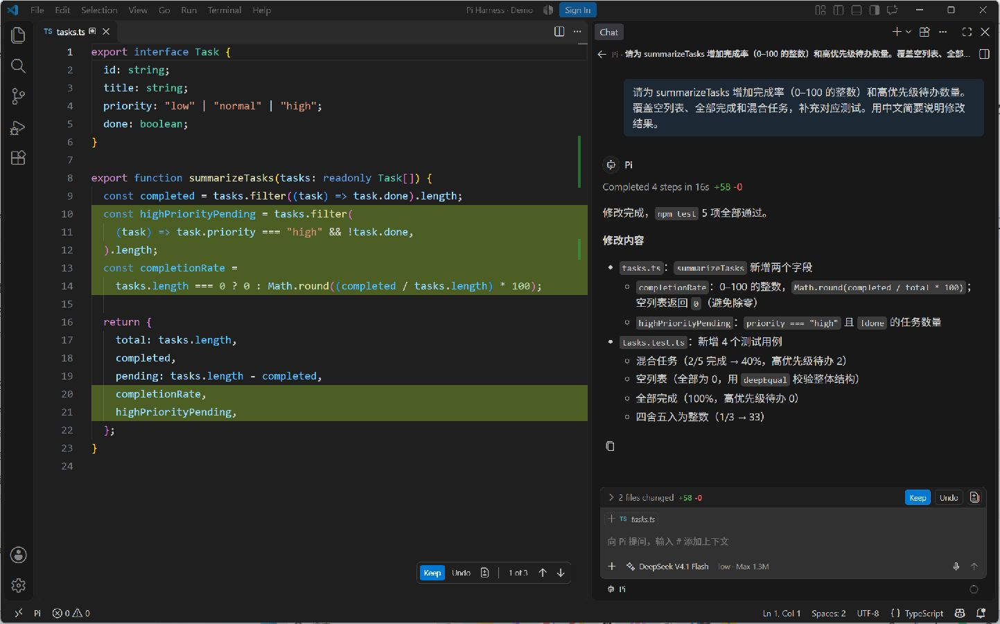
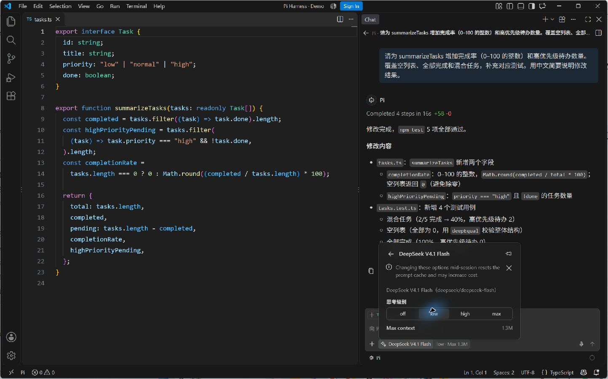
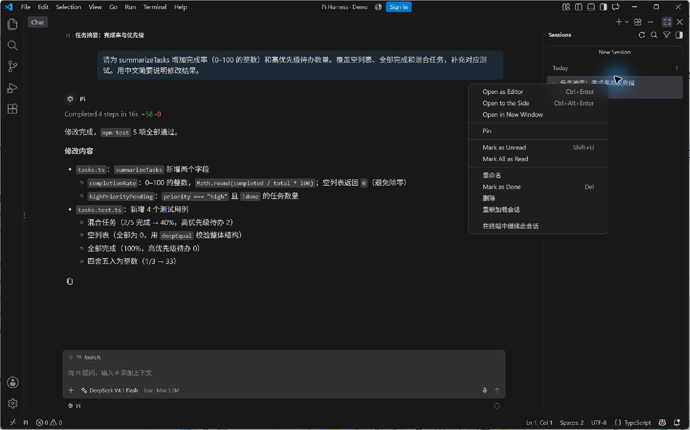

<div align="center">

# Pi Harness

**在 VS Code 原生 Chat 中，让 Pi 阅读代码、执行任务、完成修改。**

选择自己的模型，带上编辑器上下文，在同一窗口审阅结果。

[下载安装包](https://github.com/Mengzeovo/pi-vscode/releases/latest) · [安装指南](INSTALL.md) · [更新记录](CHANGELOG.md)

</div>



*真实演示：为任务摘要新增完成率与高优先级待办统计，补充测试，并在编辑器中审阅文件差异（演示项目 5 项测试全部通过）。*

## 从需求到修改，都在编辑器里

- **让上下文跟着问题走。** 附加文件、选区、符号、Problems 或图片，让 Pi 围绕当前任务工作。
- **看清每一次修改。** 在回复中直接打开文件差异并在编辑器内审阅；也可编辑历史消息，或使用 Fork Conversation 分叉会话以探索其他实现。
- **按自己的节奏交流。** 执行期间可排队发送下一条消息，或通过 Steer with Message 实时引导当前任务；停止操作仅作用于当前会话及其子任务，不影响其他会话。
- **沿用现有 Pi 资源。** 在输入框中直接调用技能，随时通过 `/reload` 重新加载当前会话的扩展、技能、MCP 与模型配置。

## 模型由你选择



模型选择器直接复用 Pi 的认证与模型配置，按已保存的 **scoped-models** 范围展示模型，并随模型能力自动提供对应的思考级别。多目录工作区会自动合并各目录的模型范围并去重。

在终端 Pi 中通过 `/scoped-models` 保存选择后，在 VS Code 执行 **Pi: 刷新 Pi 模型列表** 即可生效；未配置范围或范围为空时，默认显示全部可用模型。

## 会话可以接着用



每个 Pi 会话独立管理各自的工作目录、模型、对话历史与扩展资源。你可以随时浏览当前工作区的历史会话、重命名或重新加载资源，也可以交接到终端继续同一段对话。

同一 VS Code 窗口共用一个 Pi 后台进程，并按配置自动释放空闲会话资源；悬停状态栏的 **Pi** 按钮即可查看会话状态以及 CPU、内存占用。

## 开始使用

当前版本支持 **Windows 11 x64**（已验证 **VS Code Stable 1.145.1**），需要 **Node.js 24.15.0+** 与已安装的 **Pi**（不限制版本号，自动识别托管安装，也兼容全局 npm）。扩展通过 VSIX 安装，并需启用实验接口。

1. 安装 Pi（可通过 [pi.dev](https://pi.dev) 官方安装器或 npm 全局安装），然后在终端运行 `pi` 完成登录或模型配置：

   ```powershell
   # 若使用 npm 全局安装
   npm install -g @earendil-works/pi-coding-agent
   pi
   ```

2. 在 VS Code 中通过 **Extensions → Install from VSIX…** 安装 `pi-harness-0.2.3.vsix`，或命令行执行：

   ```powershell
   code --install-extension pi-harness-0.2.3.vsix
   ```

3. 在命令面板执行 **Preferences: Configure Runtime Arguments**，向打开的 `argv.json` 中加入：

   ```json
   "enable-proposed-api": ["local.pi-harness"]
   ```

   完全退出并重启 VS Code，打开已信任的本地项目，在 Chat 的新建会话类型中选择 **Pi** 即可开始。

关于项目资源信任、消息排队设置、文件恢复范围、自定义 Pi 路径与终端交接，见 [安装指南](INSTALL.md)。

## 开发与验证

<details>
<summary>查看构建命令与测试入口</summary>

```powershell
npm ci
npm run typecheck
npm run build
npm run package
```

测试使用独立 VS Code 配置以及真实的 Pi SDK、模型、进程与工具。准备测试用 VS Code 副本时，将下面的路径替换为本机 `Code.exe` 的实际位置：

```powershell
node dist/test/setupVscode.js "C:\Path\To\VS Code\Code.exe"
```

```powershell
npm run test:runtime
npm test
npm run test:ui
npm run test:reopen
npm run test:no-proposed
npm run test:acceptance
```

可通过环境变量 `PI_HARNESS_VSCODE` 指定其他测试用 `Code.exe`。测试配置、会话与结果均输出至 `.test-work`，安装验收使用独立扩展目录，不影响日常 VS Code 配置。界面测试基于真实 DOM 与交互事件运行，引用功能需在可读写剪贴板的桌面会话中验证。

</details>

[开发说明](DEVELOPMENT_PLAN.md) · [实际验收记录](ACCEPTANCE.md)
