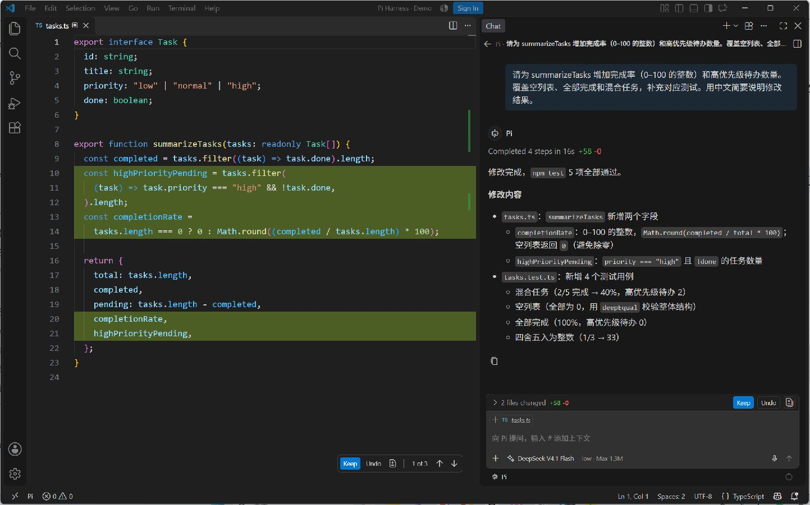
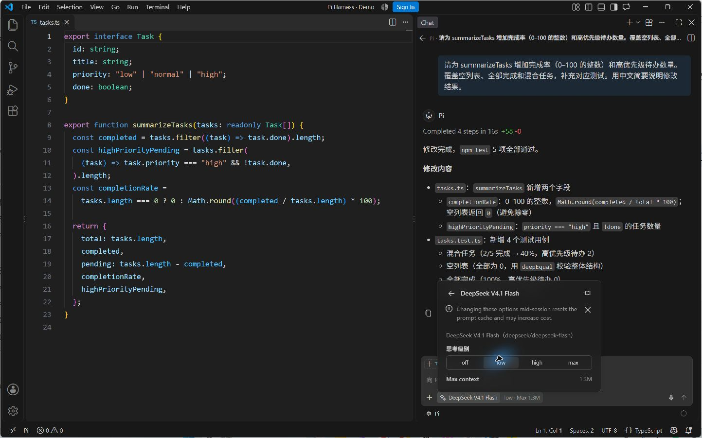
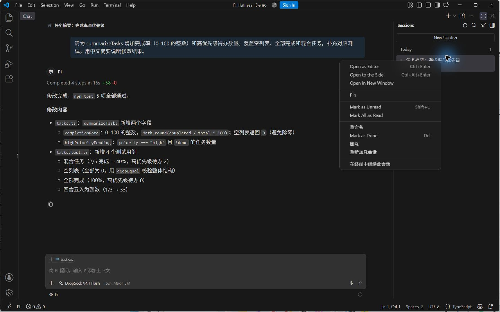

<div align="center">

# Pi Harness

**在 VS Code 原生 Chat 中，让 Pi 阅读代码、执行任务、完成修改。**

选择自己的模型，带上编辑器上下文，在同一窗口审阅结果。

[下载安装包](https://github.com/Mengzeovo/pi-vscode/releases/latest) · [安装指南](INSTALL.md) · [更新记录](CHANGELOG.md)

</div>



*真实演示：为任务摘要添加完成率与高优先级待办统计，补充测试，并在编辑器中审阅修改。演示项目的 5 项测试全部通过。*

## 从需求到修改，都在编辑器里

- **让上下文跟着问题走。** 添加文件、选区、符号、Problems 或图片，让 Pi 围绕当前任务工作。
- **看清每一次修改。** 回复中打开文件差异，在编辑器中审阅；编辑历史消息或使用 Fork Conversation，继续探索另一种实现。
- **按自己的节奏交流。** 执行期间可以排队发送下一条消息，也可以通过 Steer with Message 调整当前任务；停止操作针对当前会话及其所属任务。
- **继续使用 Pi 的资源。** 在输入框中选择技能，通过 `/reload` 重新读取当前会话的扩展、技能和模型资源。

## 模型由你选择



模型选择器使用 Pi 的认证与模型配置，并按照已保存的 **scoped-models** 范围显示模型。思考级别随模型能力提供，工作区包含多个目录时，会合并各目录的模型范围并去除重复项。

在终端 Pi 的 `/scoped-models` 中保存选择后，执行 **Pi: 刷新 Pi 模型列表** 即可读取新的范围。没有设置范围或范围为空时，显示全部可用模型。

## 会话可以接着用



Pi 会话分别保存工作目录、模型、历史和扩展资源。可以浏览当前工作区的历史，重命名会话、重新加载资源，也可以在终端中继续同一段对话。

每个 VS Code 窗口共用一个 Pi 后台，按配置释放空闲会话资源。状态栏的 **Pi** 按钮提供会话状态、CPU 和内存信息。

## 开始使用

当前版本支持 **Windows 11 x64**，已验证 **VS Code Stable 1.145.1**，需要 **Node.js 24.15.0 或更高版本**和 **Pi 1.5.0**。通过 VSIX 安装，并为本扩展启用实验接口。

1. 安装 Pi，在终端中完成模型配置或登录：

   ```powershell
   npm install -g @earendil-works/pi-coding-agent@1.5.0
   pi
   ```

2. 从 [GitHub Releases](https://github.com/Mengzeovo/pi-vscode/releases/latest) 下载 `pi-harness-0.2.1.vsix`，在 VS Code 中选择 **Extensions → Install from VSIX…**，或执行：

   ```powershell
   code --install-extension pi-harness-0.2.1.vsix
   ```

3. 执行 **Preferences: Configure Runtime Arguments**，在打开的 `argv.json` 对象中添加：

   ```json
   "enable-proposed-api": ["local.pi-harness"]
   ```

   完全退出并重新启动 VS Code，打开已信任的本地项目，在 Chat 的新建会话类型中选择 **Pi**。

项目资源信任、消息排队设置、文件恢复范围和终端交接见 [安装与使用](INSTALL.md)。

## 开发与验证

<details>
<summary>查看构建命令与测试入口</summary>

```powershell
npm ci
npm run typecheck
npm run build
npm run package
```

测试使用独立 VS Code 配置、真实 Pi SDK、模型、进程和工具。准备测试用 VS Code 副本时，将下面的路径替换为本机 `Code.exe` 的实际位置：

```powershell
node dist/test/setupVscode.js "C:\Path\To\VS Code\Code.exe"
```

```powershell
npm test
npm run test:ui
npm run test:reopen
npm run test:no-proposed
npm run test:acceptance
```

`PI_HARNESS_VSCODE` 可以指定其他测试用 `Code.exe`。测试配置、会话及结果保存在 `.test-work`；安装验收使用独立的扩展目录。界面检查通过 DOM 和实际事件完成，引用功能需要可读写剪贴板的桌面会话。

</details>

[开发说明](DEVELOPMENT_PLAN.md) · [实际验收记录](ACCEPTANCE.md)
